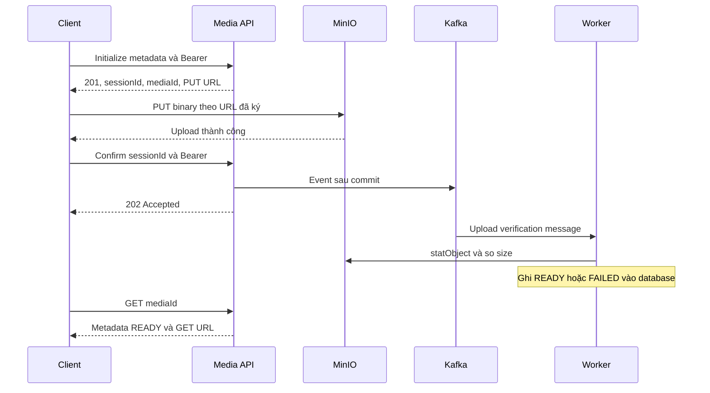

# Client guide — upload file qua presigned URL

## Luồng



## 1. Initialize

POST /api/v1/media/uploads/initialize với Content-Type: application/json và Authorization: Bearer <access-token>. Xem [request/response](initialize_upload.md). Với ảnh biển báo dùng targetType TRAFFIC_SIGN, visibility PUBLIC, mimeType image/webp và sizeBytes của file thật. Không dùng X-User-Id để thay header Authorization.

## 2. PUT trực tiếp

```javascript
const response = await fetch(initialized.presignedUrl, {
  method: 'PUT',
  headers: { 'Content-Type': file.type },
  body: file
});
if (!response.ok) throw new Error('Upload storage chưa thành công');
```

initialized là DTO API initialize đã trả, không phải initialized.data. Không thêm Authorization Identity vào request MinIO, không dùng FormData, không sửa URL đã ký. Cần CORS của storage phù hợp origin frontend khi trình duyệt gọi khác origin.

## 3. Confirm và chờ xác minh

PUT thành công mới POST /api/v1/media/uploads/{sessionId}/confirm với Bearer, không có body checksum. Nhận202 rồi chờ trạng thái do worker cập nhật. Không confirm lại như một polling endpoint. Kafka, internal MinIO endpoint và worker phải hoạt động để file đi tới READY. API hiện không có endpoint GET upload session riêng.

## 4. Dùng mediaId

GET /api/v1/media/{mediaId} để lấy metadata và URL khi READY. Client xử lý URL null, lỗi và thời hạn theo contract; không dựa vào sleep1 giây cố định để kết luận file đã sẵn sàng. Lưu mediaId trong dữ liệu nghiệp vụ, lấy URL mới khi cần. GET trước READY hiện có thể500 theo nhánh IllegalStateException; xem [contract notes](contract_notes.md).

Ảnh biển báo và ảnh câu hỏi có importer/checkpoint tại repo Content Builder. Không upload lại toàn bộ dữ liệu trên môi trường đang phục vụ chỉ vì source đã được commit/push.
